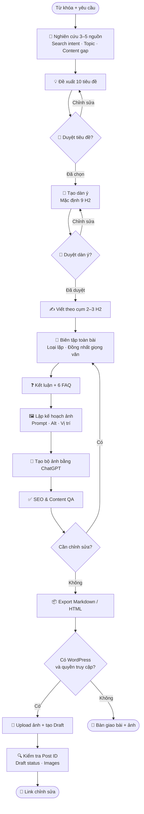
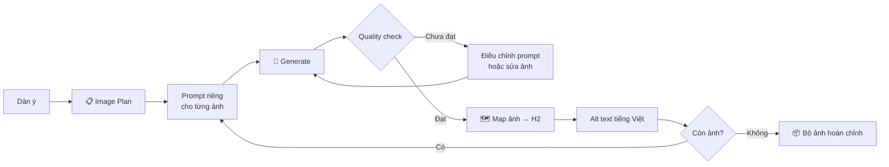
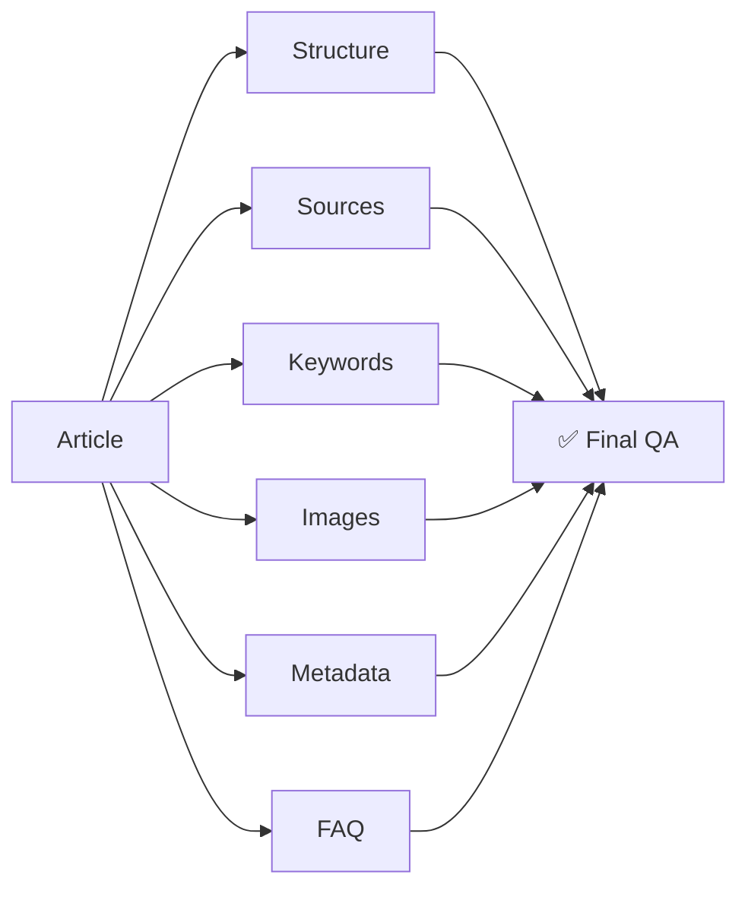
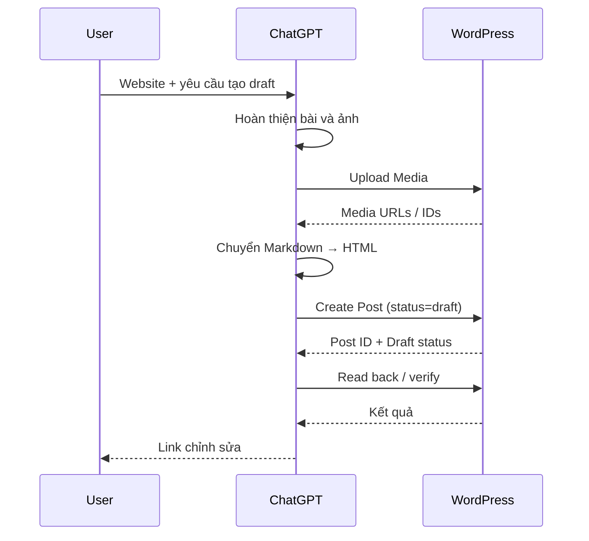

<div align="center">


# SEO Blog Writer

### Từ một từ khóa → bài blog SEO tiếng Việt → bộ ảnh AI → WordPress Draft

**Một ChatGPT Skill dành cho quy trình sản xuất nội dung SEO tiếng Việt có nghiên cứu, kiểm duyệt và khả năng bàn giao hoàn chỉnh.**

[](https://chatgpt.com/skills?skill_id=6a9992d4b6b481918e9e786f1e544565)
[](#)
[](#)
[](#)

**[Mở Skill trong ChatGPT](https://chatgpt.com/skills?skill_id=6a9992d4b6b481918e9e786f1e544565)** · **[Đọc SKILL.md](SKILL.md)** · **[Xem cấu trúc repo](#-cấu-trúc-repository)**

</div>

---

## ✨ Giới thiệu

**SEO Blog Writer** biến một từ khóa thành một quy trình sản xuất bài blog có cấu trúc thay vì chỉ tạo ra một đoạn văn dài.

Skill hướng dẫn ChatGPT đi qua toàn bộ vòng đời của một bài viết:

**Research → Search Intent → Titles → Outline → Writing → FAQ → Images → SEO QA → Export → WordPress Draft**

Mục tiêu là tạo nội dung hữu ích cho người đọc, có nguồn kiểm chứng, cấu trúc rõ ràng và dễ đưa vào quy trình xuất bản thực tế.

### Phù hợp với

- Content Writer và SEO Content Writer
- SEO Specialist
- Digital Marketer
- Blogger
- Chủ website / doanh nghiệp
- Agency và đội ngũ content
- Người cần sản xuất bài blog tiếng Việt theo quy trình nhất quán

---

## 🚀 Skill làm được gì?

| Khả năng | Mô tả |
|---|---|
| 🔎 **Nghiên cứu** | Đọc 3–5 nguồn liên quan, xác định search intent, chủ đề phụ và khoảng trống nội dung |
| 💡 **10 tiêu đề** | Đề xuất 10 tiêu đề tự nhiên, phù hợp từ khóa và mục đích tìm kiếm |
| 🧱 **Dàn ý SEO** | Mặc định 9 H2 nội dung, mỗi H2 có 2–3 luận điểm |
| ✍️ **Viết bài dài** | Mặc định khoảng 1.800–2.500 từ, có thể thay đổi theo yêu cầu |
| 📊 **Bảng so sánh** | Thêm bảng 3 cột khi nội dung có dữ liệu phù hợp để so sánh |
| ❓ **FAQ** | Kết thúc với 6 câu hỏi thường gặp dưới dạng H3 |
| 🖼️ **AI Images** | Lập kế hoạch và tạo ảnh bằng tính năng tạo ảnh tích hợp của ChatGPT |
| 🏷️ **SEO Metadata** | Tạo Meta title và Meta description |
| 📄 **Export** | Xuất Markdown; thêm HTML khi cần cho WordPress |
| 📝 **WordPress Draft** | Có thể tạo draft khi môi trường đã có website và quyền truy cập phù hợp |
| 🛡️ **Guardrails** | Không bịa nguồn, số liệu, review, thứ hạng SEO hoặc trạng thái công việc |

> **Lưu ý:** Skill là lớp hướng dẫn workflow. Khả năng tìm web, tạo ảnh, tạo file và thao tác WordPress phụ thuộc vào các công cụ thực tế đang khả dụng trong phiên ChatGPT.

---

## 🧭 Workflow tổng thể



### Hai chế độ vận hành

**Có duyệt** — ChatGPT dừng tại bước tiêu đề và dàn ý để bạn quyết định trước khi viết.

**Tự động** — nếu bạn yêu cầu làm toàn bộ tự động, skill tự chọn tiêu đề và dàn ý phù hợp, thông báo lựa chọn rồi tiếp tục. Nếu bạn đã cung cấp tiêu đề hoặc outline, skill ưu tiên dùng nội dung đó.

---

## 🔍 Chi tiết từng giai đoạn

### 0 — Research

Trước khi viết, skill tìm và đọc **3–5 nguồn liên quan** để xác định:

- Search intent: KNOW / DO / BUY / GO.
- Các chủ đề phụ người đọc cần biết.
- Câu hỏi thường gặp.
- Khoảng trống nội dung có thể khai thác.
- Dữ liệu hoặc thông tin cần nguồn kiểm chứng.

Với giá, số liệu, kỹ thuật, sức khỏe, pháp lý hoặc tài chính, skill ưu tiên nguồn gốc và nguồn có thẩm quyền.

Skill **không tự nhận một trang là “Top Google”** nếu công cụ tìm kiếm không cung cấp bằng chứng thứ hạng.

---

### 1 — Title Generation

Skill đề xuất **10 tiêu đề**:

- Dưới 120 ký tự.
- Có từ khóa hoặc biến thể tự nhiên gần đầu.
- Phù hợp search intent.
- Tránh clickbait sai lệch.
- Không hứa hẹn “Top 1 Google”.
- Chỉ dùng năm hiện tại khi nội dung thực sự được kiểm tra cho năm đó.

---

### 2 — SEO Outline

Mặc định:

```text
H1 — Tiêu đề

Mở bài

H2 — Nội dung 1
H2 — Nội dung 2
...
H2 — Nội dung 9

H2 — Kết luận

H2 — Câu hỏi thường gặp
    H3 — FAQ 1
    H3 — FAQ 2
    ...
    H3 — FAQ 6
```

**9 H2 mặc định chỉ tính phần nội dung chính.** Kết luận và FAQ nằm ngoài 9 H2 đó.

Bạn có thể yêu cầu 5 H2, 12 H2 hoặc một cấu trúc hoàn toàn khác.

---

### 3 — Writing Engine

Bài được viết theo các cụm **2–3 H2**, sau đó biên tập lại toàn bộ.

Điều này giúp:

- Giảm lặp ý.
- Giữ mạch nội dung rõ ràng.
- Dễ phân bổ độ dài.
- Dễ chia việc cho subagent khi môi trường hỗ trợ.
- Có một bước biên tập cuối để thống nhất giọng văn.

Skill ưu tiên đoạn ngắn, ví dụ cụ thể và bảng so sánh khi có dữ liệu phù hợp. Từ khóa được phân bố theo ngữ nghĩa thay vì áp một tỷ lệ mật độ cứng.

---

## 🎨 Image Generation Pipeline

Skill không lấy ảnh stock mặc định và **không cần Pexels API**.

Ảnh được tạo bằng tính năng tạo ảnh tích hợp của ChatGPT khi công cụ này khả dụng.



### Quy tắc số lượng ảnh

| Tình huống | Kết quả |
|---|---|
| 9 H2, không chỉ định số ảnh | 9 ảnh nội dung |
| 9 H2 + yêu cầu cover | 9 ảnh nội dung + 1 cover |
| 4 H2 + yêu cầu 3 ảnh + cover | 4 ảnh tổng cộng |
| Người dùng chỉ định số khác | Ưu tiên yêu cầu người dùng |

Mặc định:

- Tỷ lệ **16:9**.
- Một phong cách nhất quán cho cả bộ.
- Không có chữ, logo hoặc watermark nếu không được yêu cầu.
- Không tạo ảnh cho phần Kết luận và FAQ.
- Mỗi ảnh có alt text tiếng Việt.
- Ảnh lỗi hoặc biến thể bị loại không được tính là ảnh hoàn thành.

Nếu công cụ tạo ảnh gặp giới hạn, skill giữ các ảnh đã hoàn thành và danh sách prompt còn thiếu để có thể tiếp tục sau.

---

## 🧪 Quality Assurance

Trước khi bàn giao, skill kiểm tra:



Checklist chính:

- [ ] Tiêu đề đúng phiên bản đã chọn.
- [ ] Đúng số H2 đã duyệt.
- [ ] Nội dung không lặp giữa các section.
- [ ] Các claim quan trọng có nguồn.
- [ ] Không bịa số liệu hoặc trải nghiệm.
- [ ] Từ khóa xuất hiện tự nhiên.
- [ ] Có bảng khi dữ liệu thực sự phù hợp.
- [ ] Có Kết luận.
- [ ] Có đúng 6 FAQ theo mặc định.
- [ ] Ảnh đúng số lượng và vị trí.
- [ ] Alt text mô tả ảnh, không keyword stuffing.
- [ ] Có Meta title và Meta description.
- [ ] Link/file ảnh trong artifact trỏ tới tài nguyên thật.

---

## 📦 Output

Một workflow đầy đủ có thể tạo:

```text
seo-article/
├── article.md
├── article.html
└── images/
    ├── h2-01.png
    ├── h2-02.png
    ├── ...
    └── cover.png
```

Phần đầu Markdown có thể chứa:

```html
<!-- Meta title: ... -->
<!-- Meta description: ... -->
```

Khi không thể truy xuất file ảnh thực tế từ môi trường, skill không tạo URL giả. Thay vào đó, nó bàn giao bài, các ảnh đã hiển thị và bảng ánh xạ vị trí.

---

## 📝 WordPress Workflow

Nếu phiên ChatGPT có quyền truy cập website phù hợp:



### Nguyên tắc an toàn WordPress

- Mặc định tạo **draft**, không tự publish.
- Chỉ publish khi người dùng yêu cầu rõ ràng.
- Không hardcode username, password hoặc API key.
- Không lưu credential trong bài, ảnh hoặc repository.
- Không dùng đường dẫn local/sandbox làm URL ảnh trên website.
- Sau timeout, kiểm tra bài đã được tạo hay chưa trước khi thử lại để tránh duplicate post.

---

## ⚡ Quick Start

### Prompt tối giản

```text
Dùng $seo-blog-writer viết bài SEO về "AI marketing cho doanh nghiệp nhỏ".
```

### Prompt có kiểm duyệt

```text
Dùng $seo-blog-writer viết bài về "AI marketing cho doanh nghiệp nhỏ".

Độc giả: chủ doanh nghiệp Việt Nam.
Độ dài: khoảng 2.000 từ.

Cho tôi chọn tiêu đề và duyệt dàn ý trước khi viết.
Sau đó tạo 5 ảnh nội dung bằng ChatGPT,
phong cách minh họa tối giản, tỷ lệ 16:9.
```

### Prompt tự động

```text
Dùng $seo-blog-writer tạo bài về
"cách xây dựng kế hoạch content marketing".

Tự chọn tiêu đề và dàn ý.
Viết khoảng 2.500 từ với 9 H2.
Tạo 9 ảnh nội dung + 1 ảnh bìa bằng ChatGPT.
Phong cách hiện đại, chuyên nghiệp, tỷ lệ 16:9.

Xuất Markdown và HTML.
Nếu chưa có kết nối WordPress, giao file hoàn chỉnh.
```

### Prompt WordPress

```text
Dùng $seo-blog-writer viết bài về "SEO local cho nhà hàng".

Sau khi tôi duyệt nội dung:
- tạo bộ ảnh minh họa;
- xuất Markdown và HTML;
- tạo WordPress draft trên website tôi đã kết nối;
- không publish;
- trả lại link chỉnh sửa.
```

---

## 🧰 Công cụ & khả năng cần thiết

| Công việc | Khả năng cần có | Fallback |
|---|---|---|
| Research | Web search | Dùng nguồn người dùng cung cấp |
| Writing | ChatGPT | Viết tuần tự nếu không có subagent |
| Images | ChatGPT Image Generation | Giữ prompt + báo số ảnh còn thiếu |
| Files | File/runtime tools | Trả nội dung và nêu phần chưa xuất được |
| WordPress | Connector hoặc REST API đã xác thực | Bàn giao Markdown/HTML + ảnh |

Skill **không giả định một công cụ tồn tại**. Nếu một capability không khả dụng, các phần độc lập còn lại vẫn được hoàn thành.

---

## 📁 Cấu trúc Repository

```text
seo-blog-writer-skill/
│
├── SKILL.md
├── README.md
│
├── agents/
│   └── openai.yaml
│
└── assets/
    └── icon.svg
```

| File | Chức năng |
|---|---|
| **SKILL.md** | System workflow và các quy tắc thực thi |
| **README.md** | Tài liệu sử dụng và kiến trúc workflow |
| **agents/openai.yaml** | Tên hiển thị, mô tả ngắn và default prompt |
| **assets/icon.svg** | Icon của skill |

---

## 🧠 Nguyên tắc thiết kế

### Source-first

Thông tin có thể kiểm chứng phải dựa trên nguồn. Skill không tự dựng số liệu, giá, review hoặc bằng chứng.

### Human-in-the-loop

Tiêu đề và outline có checkpoint để người dùng kiểm soát trước khi hệ thống viết bài dài.

### Tool-aware

Skill kiểm tra capability thực tế thay vì giả định luôn có web search, image generation, file system hay WordPress.

### No fake completion

Nếu tạo được 7/9 ảnh, kết quả phải báo **7/9**, không được báo hoàn thành.

### SEO without keyword stuffing

Từ khóa và biến thể được dùng tự nhiên theo ngữ cảnh; skill không ép mật độ phần trăm hoặc lặp keyword ở mọi heading.

### Draft-first publishing

WordPress mặc định là `draft`. Publish là hành động riêng và cần yêu cầu rõ ràng.

---

## 🛡️ Guardrails

Skill được thiết kế để tránh:

- ❌ Bịa nguồn hoặc citation.
- ❌ Tuyên bố thứ hạng Google khi không có dữ liệu.
- ❌ Hứa bài viết sẽ đạt Top 1.
- ❌ Bịa review hoặc trải nghiệm cá nhân.
- ❌ Keyword stuffing.
- ❌ Tạo URL ảnh giả.
- ❌ Hardcode credential.
- ❌ Tự publish WordPress ngoài yêu cầu.
- ❌ Báo hoàn thành khi công cụ thực tế đã lỗi.

---

## 🔧 Tùy biến

Bạn có thể thay đổi ngay trong prompt:

| Thuộc tính | Ví dụ |
|---|---|
| Ngôn ngữ | Tiếng Việt, English |
| Độc giả | Người mới, chuyên gia, chủ doanh nghiệp |
| Độ dài | 1.200 / 2.000 / 4.000 từ |
| Số H2 | 5 / 9 / 12 |
| Tone | Chuyên gia, thân thiện, kỹ thuật |
| Số ảnh | 3 / 5 / 9 / tùy ý |
| Aspect ratio | 16:9, 1:1 |
| Image style | Editorial, minimal, realistic |
| Approval | Có duyệt / tự động |
| Output | Markdown / HTML |
| Publishing | File / WordPress draft |

---

## ❓ FAQ

<details>
<summary><strong>Skill có tự động đăng bài lên WordPress không?</strong></summary>

Không mặc định. Khi có kết nối phù hợp, skill tạo bài ở trạng thái **draft**. Chỉ publish khi bạn yêu cầu rõ ràng.

</details>

<details>
<summary><strong>Có cần API key tạo ảnh không?</strong></summary>

Không đối với tính năng tạo ảnh tích hợp của ChatGPT. Việc tạo ảnh vẫn phụ thuộc vào capability đang khả dụng trong phiên.

</details>

<details>
<summary><strong>Có bắt buộc phải dùng 9 H2 không?</strong></summary>

Không. 9 H2 là cấu hình mặc định. Bạn có thể yêu cầu số lượng và cấu trúc khác.

</details>

<details>
<summary><strong>Có bắt buộc tạo 9 ảnh không?</strong></summary>

Không. Khi bạn không chỉ định, skill mặc định một ảnh cho mỗi H2 nội dung. Yêu cầu của bạn luôn được ưu tiên.

</details>

<details>
<summary><strong>Skill có đảm bảo bài viết lên Top Google không?</strong></summary>

Không. Skill hỗ trợ quy trình nghiên cứu, cấu trúc và tối ưu nội dung nhưng không hứa hẹn thứ hạng tìm kiếm.

</details>

---

## 🔗 Links

- **Skill specification:** [SKILL.md](SKILL.md)
- **OpenAI agent metadata:** [agents/openai.yaml](agents/openai.yaml)
- **Skill icon:** [assets/icon.svg](assets/icon.svg)
- **ChatGPT:** [Mở SEO Blog Writer](https://chatgpt.com/skills?skill_id=6a9992d4b6b481918e9e786f1e544565)

---

<div align="center">

### SEO Blog Writer

**Research → Write → Illustrate → Validate → Deliver**

Nếu repository này hữu ích, bạn có thể ⭐ repo để dễ tìm lại.

</div>
