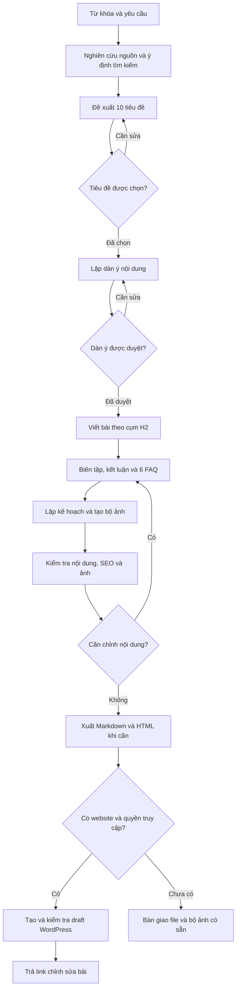

# SEO Blog Writer

**Từ một từ khóa đến bài blog SEO tiếng Việt, bộ ảnh minh họa bằng ChatGPT và bản nháp WordPress.**

SEO Blog Writer là skill hướng dẫn ChatGPT thực hiện quy trình viết bài: nghiên cứu nguồn, đề xuất tiêu đề, xây dựng dàn ý, viết nội dung, tạo ảnh và kiểm tra trước khi bàn giao. Phù hợp cho người làm content, marketing, chủ website và đội ngũ sản xuất blog tiếng Việt.

Ảnh được tạo bằng **tính năng tạo ảnh tích hợp của ChatGPT**, theo số lượng bài viết cần. Bước WordPress thực hiện khi có website được chỉ định và quyền truy cập phù hợp.

[Đọc hướng dẫn đầy đủ trong SKILL.md](SKILL.md) · [Mở skill đã cài trong ChatGPT](https://chatgpt.com/skills?skill_id=6a9992d4b6b481918e9e786f1e544565)

## Bạn nhận được gì?

- 10 gợi ý tiêu đề phù hợp với từ khóa và mục tiêu tìm kiếm.
- Dàn ý mặc định 9 H2 nội dung, có điểm duyệt trước khi viết.
- Bài viết tiếng Việt khoảng 1.800–2.500 từ, kèm kết luận và 6 câu FAQ.
- Bộ ảnh minh họa nhất quán về phong cách, prompt riêng và alt tiếng Việt cho từng ảnh.
- Meta title, meta description và file Markdown; HTML khi cần đưa lên WordPress.
- Bản nháp WordPress và link chỉnh sửa khi đã có kết nối phù hợp.

Số H2, độ dài, số ảnh, phong cách và cách duyệt đều có thể điều chỉnh theo yêu cầu của bạn.

## Flowchart tổng thể

Sơ đồ thể hiện hai điểm duyệt nội dung, vòng chỉnh sửa và hai cách bàn giao cuối quy trình.

## Cấu trúc repo

| File | Vai trò |
|---|---|
| [SKILL.md](SKILL.md) | Hướng dẫn thực thi toàn bộ quy trình |
| [agents/openai.yaml](agents/openai.yaml) | Tên hiển thị, mô tả ngắn và prompt khởi đầu |
| [assets/icon.svg](assets/icon.svg) | Tài nguyên biểu tượng |
| [README.md](README.md) | Giới thiệu, sơ đồ quy trình và ví dụ sử dụng |

## Nguyên tắc chất lượng

- Nguồn và thông tin có thể kiểm chứng; không sao chép bài đối thủ hoặc bịa số liệu.
- Từ khóa phân bố tự nhiên, không áp mật độ phần trăm cứng.
- Không hứa thứ hạng tìm kiếm.
- Không lưu thông tin xác thực trong skill, bài viết hoặc repo.
- Chỉ báo hoàn thành những bước đã thực hiện và kiểm tra được.
